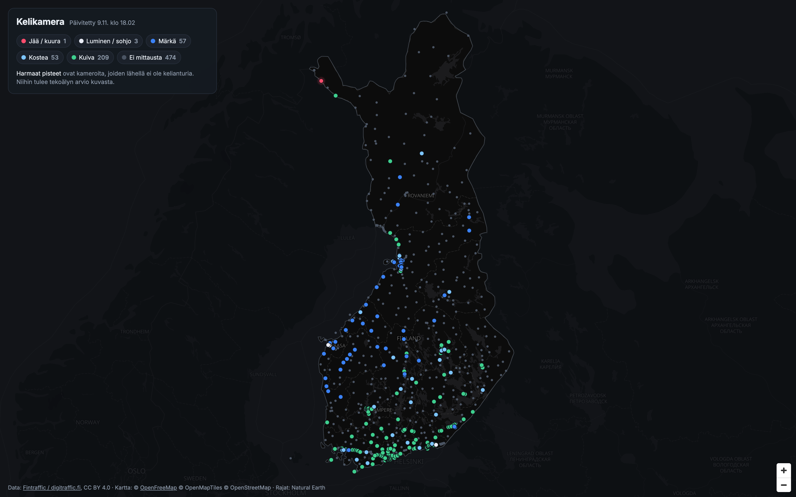
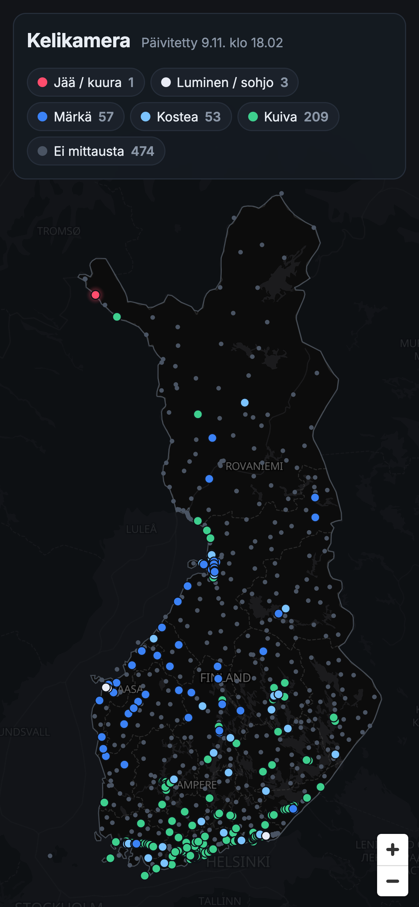

# Edistyminen

Mitataan samoilla mittareilla koko projektin ajan, jotta lopussa voidaan näyttää konkreettisesti,
mitä tekoäly toi lisää. Kuvat otetaan aina samalla tavalla: `python tools/screenshot.py <url> docs/progress/<pvm>`.

## Mittarit

| Mittari | Mitä se kertoo |
|---|---|
| **Kameroita kartalla** | Kuinka monta kelikameraa oli toiminnassa ajohetkellä |
| **Mitattu keli** | Kamerat, joilla on optinen kelianturi alle 5 km päässä |
| **Tekoälyn arvio** | Kamerat, joille keli on vain mallin arvio kuvasta |
| **Ei tietoa** | Kamerat, joista ei ole kumpaakaan |
| **Mallin tarkkuus** | Testijoukossa, *kameroilla joita malli ei ole nähnyt*: kuinka moni liukas tie tunnistetaan (recall) ja kuinka usein "liukas"-hälytys on aiheellinen (precision) |

**Tärkeä sääntö väitteille:** kattavuusluku ei yksin todista mitään, koska malli, joka arvaa kaikkialle
"kuiva", nostaisi kattavuuden sataan prosenttiin. Kattavuus esitetään aina yhdessä tarkkuuden kanssa.
Esimerkki kestävästä otsikosta: *"Kelitieto 797 kameralle 323:n sijaan, ja liukas tie tunnistetaan X %:n
tarkkuudella kameroilla, joita malli ei ole koskaan nähnyt."*

## Lokikirja

### 2026-11-09 · Lähtötaso (ei mallia)

| Kameroita | Mitattu keli | Tekoälyn arvio | Ei tietoa | Mallin tarkkuus |
|---:|---:|---:|---:|---|
| 797 | 323 (40,5 %) | 0 | 474 (59,5 %) | – |

Kartta ennen tekoälyä: kuusi kymmenestä kamerasta ilman kelitietoa.

Huom: marraskuun alku, joten talviluokkia ei juuri ole (jää/kuura 1, luminen 3 kameraa).
Ajo 2026-11-09 klo 16:02 UTC.
