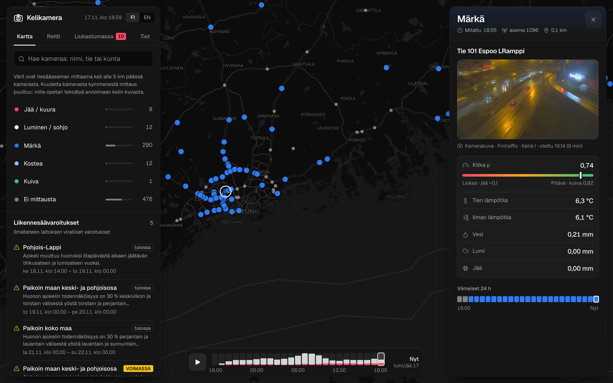
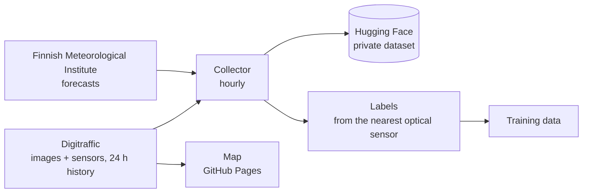

# Kelikamera AI

[](https://github.com/petudesign/kelikamera/actions/workflows/ci.yml)
[](https://github.com/petudesign/kelikamera/actions/workflows/collect.yml)

Road surface condition and friction from Fintraffic's road weather cameras. Six in ten cameras have no surface sensor
nearby; the goal is a local model that estimates the condition straight from the image.

**[Open the map →](https://petudesign.github.io/kelikamera/)**



## How it works



- **Training data without hand-labelling.** Each image is paired with the optical surface sensor of the nearest road
  weather station (≤ 5 km) at the moment the image was taken (±10 min). Thin snow and ice layers with good friction
  are flagged separately.
- **Collection by the clock, not by the run.** Fixed moments every three hours are filled in afterwards from
  Digitraffic's history, so a dropped run loses no data. Cameras in winter conditions are collected hourly.
- **The map is useful before the model exists:** measured conditions, a 24-hour timeline, roads getting slippery,
  a view per road, route search and official traffic weather warnings, in Finnish and English.

## Status

| | |
|---|---|
| Cameras | ~800, of which ~325 have a measured condition |
| Training data | over 30 distinct cameras in all five classes (ice 84, snow 123) |
| Next | label quality checks, then training (DINOv2 + a small head) |

Decisions and their reasons: [DECISIONS.md](DECISIONS.md) · progress: [PROGRESS.md](PROGRESS.md) ·
roadmap: [ROADMAP.md](ROADMAP.md) (in Finnish)

## Structure

```
collector/   collection, labels and map data (Python)
site/        the map: HTML, CSS and plain scripts, no framework or build step
tests/       unit tests (pytest)
tools/       browser checks and screenshots (headless Chrome)
```

GitHub Actions runs collection and publishing hourly, a training-data readiness report daily, and the tests and
browser checks (core features, layout, external servers) on every push.

## Development

```bash
python3 -m venv .venv && .venv/bin/pip install -r requirements.txt -r requirements-dev.txt
.venv/bin/python -m pytest -q tests
.venv/bin/python collector/collect.py --dry-run     # what the collector would fetch
.venv/bin/python collector/build_site.py            # map data
.venv/bin/python tools/serve.py                     # http://localhost:8765/
.venv/bin/python tools/smoke_test.py
```

## Data and licences

Images and sensor data: Fintraffic / [digitraffic.fi](https://www.digitraffic.fi/), CC BY 4.0.
Forecasts and warnings: [Finnish Meteorological Institute](https://en.ilmatieteenlaitos.fi/open-data), CC BY 4.0.
Map: OpenFreeMap, © OpenMapTiles, © OpenStreetMap. Place search Photon (komoot), routing OSRM (FOSSGIS).
Font Geist (OFL 1.1), icons Lucide (ISC), map library MapLibre GL JS (BSD-3).
