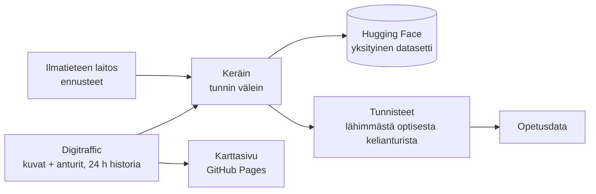

# Kelikamera AI

[](https://github.com/petudesign/kelikamera/actions/workflows/ci.yml)
[](https://github.com/petudesign/kelikamera/actions/workflows/collect.yml)

Tien pinnan tila ja kitka Fintrafficin kelikameroiden kuvista. Kuudelta kamerasta kymmenestä puuttuu lähellä oleva
kelianturi; tavoite on paikallinen malli, joka arvioi kelin suoraan kuvasta.

**[Avaa kartta →](https://petudesign.github.io/kelikamera/)**


## Miten se toimii



- **Opetusdata ilman käsin merkitsemistä.** Jokainen kuva yhdistetään lähimmän tiesääaseman (≤ 5 km) optiseen
  kelianturiin kuvan ottohetkellä (±10 min). Ohuet lumi- ja jääkerrokset hyvällä kitkalla merkitään erikseen.
- **Keruu kellon mukaan, ei ajon.** Kiinteät keruuhetket kolmen tunnin välein haetaan Digitrafficin historiasta
  jälkikäteen, joten pudonnut ajo ei hävitä dataa. Talvisilta kameroilta kuvat tunnin välein.
- **Kartta toimii jo ennen mallia:** mitattu keli, 24 tunnin aikajana, liukastuvat tiet, tiekohtainen näkymä,
  reittihaku ja viralliset liikennesäävaroitukset suomeksi ja englanniksi.

## Tilanne

| | |
|---|---|
| Kameroita | ~800, joista ~325 mitatulla kelillä |
| Opetusdata | kaikissa viidessä luokassa yli 30 eri kameraa (jää 84, lumi 123) |
| Seuraavaksi | tunnisteiden laadun varmistus, sitten mallin koulutus (DINOv2 + pieni pää) |

Päätökset perusteluineen: [DECISIONS.md](DECISIONS.md) · edistyminen: [PROGRESS.md](PROGRESS.md) ·
tiekartta: [ROADMAP.md](ROADMAP.md)

## Rakenne

```
collector/   keruu, tunnisteet ja sivun data (Python)
site/        karttasivu: HTML, CSS ja tavalliset skriptit ilman kehystä tai käännösvaihetta
tests/       yksikkötestit (pytest)
tools/       selaintarkistukset ja kuvakaappaukset (Chrome ilman ikkunaa)
```

GitHub Actions ajaa keruun ja julkaisun tunnin välein, opetusdatan valmiusraportin päivittäin sekä testit ja
selaintarkistukset (päätoiminnot, asettelu, ulkoiset palvelimet) jokaisessa pushissa.

## Kehitys

```bash
python3 -m venv .venv && .venv/bin/pip install -r requirements.txt -r requirements-dev.txt
.venv/bin/python -m pytest -q tests
.venv/bin/python collector/collect.py --dry-run     # mitä keräin hakisi
.venv/bin/python collector/build_site.py            # sivun data
.venv/bin/python tools/serve.py                     # http://localhost:8765/
.venv/bin/python tools/smoke_test.py
```

## Data ja lisenssit

Kuvat ja anturidata: Fintraffic / [digitraffic.fi](https://www.digitraffic.fi/), CC BY 4.0.
Ennusteet ja varoitukset: [Ilmatieteen laitos](https://www.ilmatieteenlaitos.fi/avoin-data), CC BY 4.0.
Kartta: OpenFreeMap, © OpenMapTiles, © OpenStreetMap. Paikkahaku Photon (komoot), reititys OSRM (FOSSGIS).
Fontti Geist (OFL 1.1), ikonit Lucide (ISC), kartta MapLibre GL JS (BSD-3).
